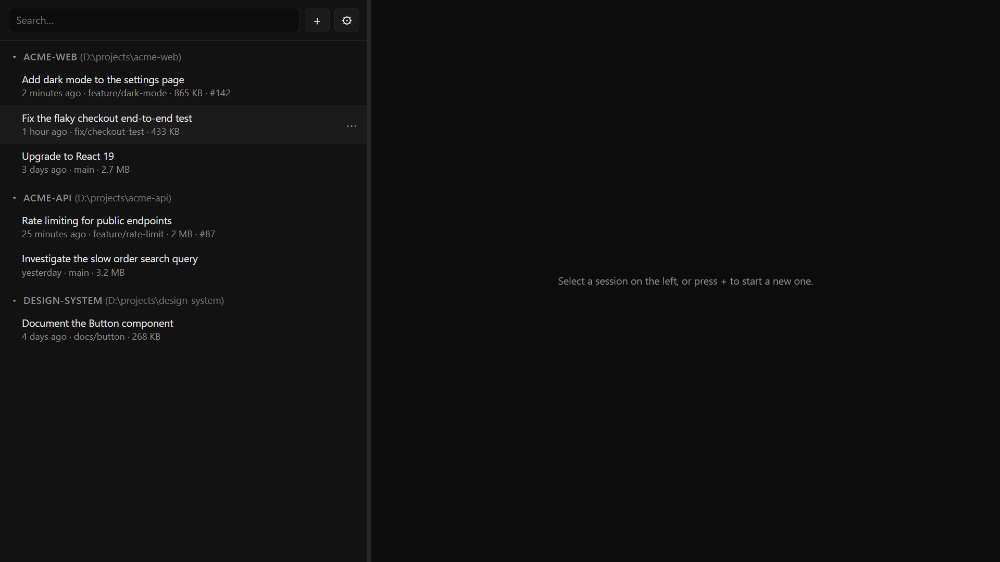
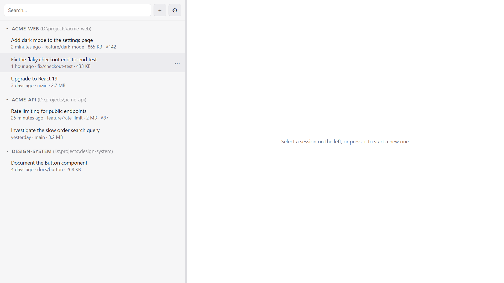

# Rowan

All your Claude Code sessions in one window: every session in a list on the left, and a real `claude` console per session on the right. Several sessions run at the same time; one is shown, the others keep running in the background.

**[Download the latest version](https://github.com/nicolasdev/rowan-releases/releases/latest)** for Windows or macOS.

> Rowan is an independent project. It is not affiliated with or endorsed by Anthropic. Claude and Claude Code are products of Anthropic.

## Why "Rowan"?

Each letter stands for a feature:

- **R**esume: pick up any Claude Code session where you left it.
- **O**bfuscation: hide the title of a sensitive conversation behind three stand-in words.
- **W**orktrees: start a session in a new git worktree, and delete it when you are done.
- **A**ctivity: see at a glance which consoles are open and where Claude is working.
- **N**avigation: move through the list and the grid with the mouse or the keyboard.

## Features

- **Every session in one list**, grouped by project, with its title, git branch, size and pull request number. The search ignores case and accents.
- **Open sessions apart**: the sessions with an open console are listed in an Active group above the projects, so Claude writing to them does not reorder the list.
- **Real consoles**: each session runs the `claude` CLI itself, not a re-implementation, so everything you know from the terminal works the same.
- **Activity at a glance**: a dot marks the consoles open in Rowan, and turns into a spinning half circle while Claude is working. When Claude is working in at least one session, a half circle also spins in the window title, and a dot appears on the Dock icon (macOS).
- **Several consoles side by side** in a grid, each one usable as in a terminal.
- **Rename** a session: the name is the one `/rename` sets, so `claude --resume` shows it too.
- **Start a new session** in a recent folder or any other folder, or in a new git worktree so that parallel sessions do not touch the same files. A worktree session is named after its worktree, and ⎇ marks it in the list.
- **Obfuscate** the title of a sensitive conversation: three stand-in words in italics replace it in the list and the grid, and the real title shows while the pointer is over it.
- **Unload** a conversation to free the memory of its `claude` process.
- **Delete** a conversation, or a worktree with its conversations and, if you choose, its branch.
- Dark, light or system **theme**, adjustable **font sizes**, interface in **English, French and Spanish**.

## Install

You need Claude Code installed and logged in: `claude` must work in a terminal.

Rowan was named Claudio up to version 1.5.2. It installs alongside Claudio and starts with default settings: uninstall Claudio yourself once Rowan is set up.

Download the installer for your system from the [latest release](https://github.com/nicolasdev/rowan-releases/releases/latest):

| System | File |
|---|---|
| Windows (x64) | `Rowan-<version>-win-x64.exe` |
| macOS, Apple Silicon | `Rowan-<version>-mac-arm64.dmg` |
| macOS, Intel | `Rowan-<version>-mac-x64.dmg` |

The installers are not code-signed yet, so the first launch shows a warning:

- **Windows**: on "Windows protected your PC", click **More info**, then **Run anyway**.
- **macOS**: the first launch is blocked. Open **System Settings → Privacy & Security** and click **Open Anyway** next to the message about Rowan.

## Usage

| Action | How |
|---|---|
| Resume a session | Click it in the list |
| New session | **+** → New session…, or `Ctrl+N` (`⌘N` on Mac); then a recent folder or "Other folder…" |
| New session in a git worktree | **+** → New worktree…, then the repository and an optional name (spaces become dashes): Claude Code creates a branch and a folder in `<repo>/.claude/worktrees` and starts the session there |
| Rename | `F2`, double-click the title, or **⋯** → Rename |
| Unload a conversation | **⋯** → Unload conversation: stops its `claude` process and frees its console |
| Delete a conversation | **⋯** → Delete conversation…: permanently deletes its transcript; the project folder is not touched |
| Delete a worktree | **⋯** → Delete worktree… on a session in a worktree: permanently deletes its folder, its uncommitted changes and the conversations started in it; a box also deletes its branch. git must be in the PATH |
| Hide a title | **⋯** → Obfuscate title; point at the stand-in words to read the real title; **⋯** → Stop obfuscating title to show it again |
| Several consoles side by side | **⋯** → Add to grid on each session (▦ in the list marks them); **▦** next to ⚙ switches between the grid and one console; click a tile to type in it, its close button removes it from the grid |
| Collapse a project | Click its name in the list |
| Resize the list | Drag the separator (the width is remembered) |
| New line in the prompt | `Shift+Enter`, or `Ctrl+Enter` if chosen in Settings (⚙) |
| Copy / paste | `Ctrl+C` on a selection / `Ctrl+V` (`⌘C` / `⌘V` on Mac) |
| Theme, text size, language | Settings (⚙) |
| Keyboard only | `Tab` to the list, arrows to move, `Enter` to open, `F2` to rename, `Shift+F10` or the Menu key for the session menu |

"folder not found" means the session's original folder no longer exists on this machine. Claude Code only resumes a session from its original folder, so restore or recreate that folder at the same path.

Rowan finds your sessions in `~/.claude`, or in `$CLAUDE_CONFIG_DIR` when that variable is set. Settings (⚙) → "Add folder…" adds other Claude configuration folders, for example `~/.claude-work` if you use several accounts.

## Privacy

- Rowan runs on your machine and sends nothing over the network itself. The `claude` consoles it starts talk to Anthropic exactly as they do in a terminal.
- It reads the session transcripts in your Claude configuration folders. It writes to them only to rename a session, by appending one line, and deletes them only when you delete a conversation or a worktree.

## Good to know

- Rowan relies on parts of Claude Code that are internal and undocumented: the transcript format, the record written by `/rename`, and the terminal title Claude sets while it works. A Claude Code update can break the list, renaming or the activity indicator until Rowan is updated.
- Do not open in Rowan a session that is already open in another terminal: two `claude` processes would write to the same session.
- Closing Rowan stops the running sessions. It asks for confirmation only when Claude is working in at least one of them.
- Deleting a conversation or a worktree cannot be undone. Both ask for confirmation, with Cancel selected. A running console is stopped first; if Claude Code does not stop in time, nothing is deleted.
- Unloading a conversation or closing Rowan asks Claude to quit, which takes a few seconds, so that it shuts down cleanly. A session in a git worktree is stopped at once instead: on quitting, Claude Code would delete an unchanged worktree, or wait for an answer about a changed one. Its worktree stays locked until the session is resumed; to remove it by hand, run `git worktree unlock <path>` first.
- Linux is not supported yet.

## License

Rowan is freeware: free to use, for personal or commercial purposes. See [LICENSE](LICENSE).
