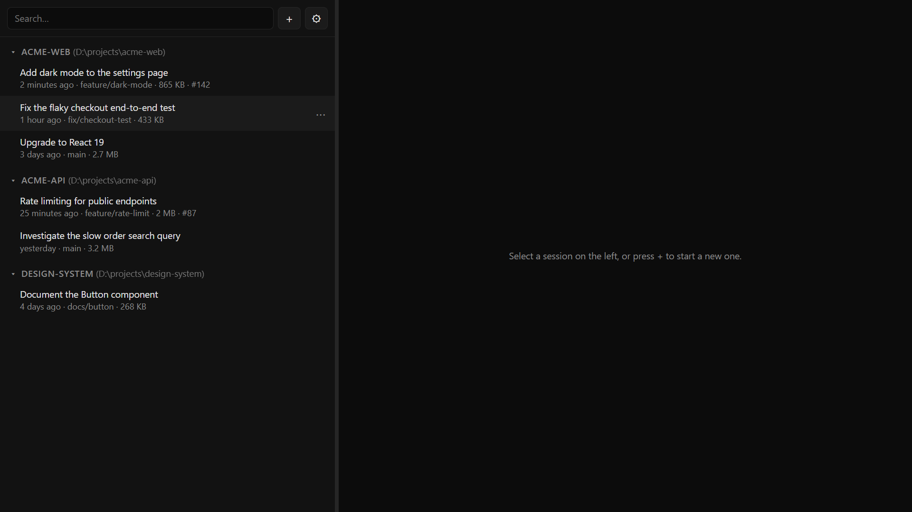
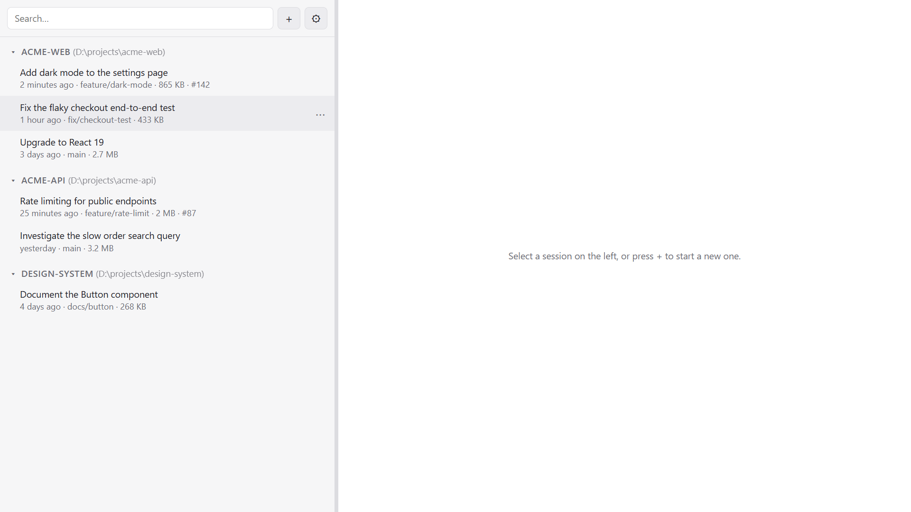

# Emilio

All your Claude Code sessions in one window: every session in a list on the left, and a real `claude` console per session on the right. Several sessions run at the same time; one is shown, the others keep running in the background.

**[Download the latest version](https://github.com/nicolasdev/emilio-releases/releases/latest)** for Windows or macOS.

> Emilio is an independent project. It is not affiliated with or endorsed by Anthropic. Claude and Claude Code are products of Anthropic.

## Why "Emilio"?

Each letter stands for a feature:

- **E**very session: all your Claude Code sessions in one list, ready to pick up where you left them.
- **M**obile: use Emilio from your phone or another computer, through Tailscale.
- **I**solation: start a session in a new git worktree, and delete it when you are done.
- **L**imits: your Claude usage limits under the list.
- **I**ndicators: see at a glance which consoles are open and where Claude is working.
- **O**bfuscation: hide the title of a sensitive conversation behind three stand-in words.

## Features

- **Every session in one list**, grouped by project, with its title, git branch, size and pull request number. The search ignores case and accents, and also looks through your messages and Claude's answers: the sessions found there are listed below the others, with the passage that matches.
- **Open sessions apart**: the sessions with an open console are listed in an Active group above the projects, so Claude writing to them does not reorder the list.
- **Real consoles**: each session runs the `claude` CLI itself, not a re-implementation, so everything you know from the terminal works the same.
- **Activity at a glance**: a dot marks the consoles open in Emilio, and turns into a spinning half circle while Claude is working. When Claude is working in at least one session, a half circle also spins in the window title, and a dot appears on the Dock icon (macOS).
- **Several consoles side by side** in a grid, each one usable as in a terminal.
- **A system console under each session**: PowerShell on Windows, your zsh or bash on macOS, in the session's folder. Claude can run commands in it, with your permission and in front of you, and receives only the output of the commands it runs there.
- **Rename** a session: the name is the one `/rename` sets, so `claude --resume` shows it too.
- **Start a new session** in a recent folder or any other folder, or in a git worktree, new or existing, so that parallel sessions do not touch the same files. A worktree session is named after its worktree, and ⎇ marks it in the list, wherever the worktree is.
- **Obfuscate** the title of a sensitive conversation: three stand-in words in italics replace it in the list and the grid, and the real title shows while the pointer is over it.
- **Unload** a conversation to free the memory of its `claude` process.
- **Files as Markdown**: drop a Word, Excel, PowerPoint or PDF file on a console, and Claude gets the path of a Markdown copy, converted on your computer.
- **Delete** a conversation, or a worktree with its conversations and, if you choose, its branch.
- **Usage limits** under the list, read from Claude Code's `/usage` on demand or every 5 minutes: current session, week, and week per model.
- **Remote access** from your phone or another computer, through Tailscale: the whole Emilio, list and consoles, with a key bar and a text field made for a phone keyboard.
- **New versions** reported by a red dot on ⚙, from a check on GitHub once a day or when you ask; nothing is downloaded or installed.
- **Built-in help**, searchable, under **?** next to ⚙.
- Dark, light or system **theme**, adjustable **font sizes**, interface in **English, French and Spanish**.

## Install

You need Claude Code installed and logged in: `claude` must work in a terminal.

Emilio was named Rowan up to version 2.1.1, and Claudio up to version 1.5.2. It installs alongside them and starts with default settings: uninstall Rowan or Claudio yourself once Emilio is set up.

Download the installer for your system from the [latest release](https://github.com/nicolasdev/emilio-releases/releases/latest):

| System | File |
|---|---|
| Windows (x64) | `Emilio-<version>-win-x64.exe` |
| macOS, Apple Silicon | `Emilio-<version>-mac-arm64.dmg` |
| macOS, Intel | `Emilio-<version>-mac-x64.dmg` |

The installers are not code-signed yet, so the first launch shows a warning:

- **Windows**: on "Windows protected your PC", click **More info**, then **Run anyway**.
- **macOS**: the first launch is blocked. Open **System Settings → Privacy & Security** and click **Open Anyway** next to the message about Emilio.

## Usage

| Action | How |
|---|---|
| Resume a session | Click it in the list |
| New session | **+** → New session…, or `Ctrl+N` (`⌘N` on Mac); then a recent folder, "Folder in <name>…" or "Other folder…". "Folder in <name>…" appears once Settings (⚙) → Claude Code → "Projects folder" is set: it lists the folders already there, filtered as you type, and starts the session in the one you click, or in the folder whose name you type: the button reads "Open" for an existing folder and "Create" for a new one |
| New session in a git worktree | **+** → New worktree…, then the repository, an optional name (spaces become dashes) and where it starts: the remote's default branch (`origin/main`), or your current branch with its unpushed commits. Uncommitted changes are not carried over, except the ignored files listed in `.worktreeinclude`. Claude Code creates a branch and a folder in `<repo>/.claude/worktrees` and starts the session there |
| New session in an existing worktree | **+** → Add existing worktree…, then the repository and one of its worktrees, created by Claude Code or by `git worktree add` |
| Rename | `F2`, double-click the title, or **⋯** → Rename |
| Let two sessions talk | **⋯** → Copy name for other sessions, on a running session: copies the name Claude uses to message it (not its title in the list), to paste in another session, as in "send a message to emilio-11" |
| Unload a conversation | **⋯** → Unload conversation: stops its `claude` process and frees its console |
| Delete a conversation or a worktree | **⋯** → Delete…: permanently deletes the conversation's transcript; the project folder is not touched. On a session in a worktree, boxes choose what goes: the conversation (checked), the worktree with its folder, its uncommitted changes and every conversation started in it, and its branch. git must be in the PATH to delete a worktree |
| Hide a title | **⋯** → Obfuscate title; point at the stand-in words to read the real title; **⋯** → Stop obfuscating title to show it again |
| Several consoles side by side | **⋯** → Add to grid on each session (▦ in the list marks them); **▦** next to ⚙ switches between the grid and one console; click a tile to type in it, its close button removes it from the grid |
| System console under a session | **>_** on the session's row (it shows on hover, and stays pressed while the console is open; on a phone it only shows that a console is open on the computer) or **⋯** → Open a PowerShell console (zsh or bash on macOS), while the session runs; drag the line above it to share the tile, **ⓘ** says what Claude sees of it, **×** closes it. Then ask Claude to run something "in the console". Settings (⚙) → Consoles can keep Claude out of it, for the sessions started afterwards |
| Collapse a project | Click its name in the list |
| Resize the list | Drag the separator (the width is remembered) |
| New line in the prompt | `Shift+Enter`, or `Ctrl+Enter` if chosen in Settings (⚙) → Consoles |
| Copy / paste | `Ctrl+C` on a selection / `Ctrl+V` (`⌘C` / `⌘V` on Mac), or right-click: copies the selection, or pastes when nothing is selected (except while Claude Code's fullscreen renderer holds the mouse) |
| Give Claude a file | Drag it onto a console, then drop it on **Convert to Markdown** (Word, Excel, PowerPoint, PDF, OpenDocument, RTF, EPUB, HTML: the path of a Markdown copy is pasted) or on **Paste the path** (the file as it is). Settings (⚙) → Dropped files turns the conversion off: the path is then pasted at once |
| Theme, text size, language | Settings (⚙) |
| Usage limits | Settings (⚙) → Claude Code → "Show the usage limits", then **⟳** under the list, or **Auto** to read them again every 5 minutes while the window shows; point at a value for its reset time |
| New version | A red dot on ⚙; at the bottom of Settings, **New version: x.y.z** opens its release page. Settings (⚙) → About → **Check now** checks at once, and "Check for new versions" turns the daily check off |
| Use Emilio from your phone | See [Remote access](#remote-access) |
| Help | **?** next to ⚙: the guide of Emilio, with a search |
| Keyboard only | `Tab` to the list, arrows to move, `Enter` to open, `F2` to rename, `Shift+F10`, the Menu key or `Ctrl+Enter` (`⌃↩` on macOS) for the session menu |

"folder not found" means the session's original folder no longer exists on this machine. Claude Code only resumes a session from its original folder, so restore or recreate that folder at the same path.

Emilio finds your sessions in `~/.claude`, or in `$CLAUDE_CONFIG_DIR` when that variable is set.

To use several Claude accounts, open Settings (⚙) → Accounts: it lists each account with its state, and logs it in or out; logging in opens a window of Emilio with no session, where claude.com asks which account to log in, whatever account your browser has open. If that window refuses your sign-in (Google, for instance), copy the link shown in the account's row, open it in a private window of your browser, and paste back the code it gives. "New account…" creates `~/.claude-<name>` and logs it in; "Add existing account…" adds a configuration folder you already use with `CLAUDE_CONFIG_DIR`, for example `~/.claude-work`. Each session then runs with its own account, the list shows the account's email next to the project, and a new session in a folder chosen by name or with Other folder… asks which account to use. "Remove" takes an account off the list and leaves its folder on the disk, with its login and its conversations; its confirmation can also log the account out and move the folder to the Recycle Bin (the Trash on macOS). From the phone, you can see the accounts, log them out and remove them.

## Remote access

Emilio can be used from your phone or another computer: the same list, the same consoles. It only listens on your computer and publishes itself through [Tailscale](https://tailscale.com), a private network between your own devices, on `https://<computer>.<tailnet>.ts.net:47823`. Nothing is opened on your router or your local network.

1. Install Tailscale on the computer that runs Emilio and on your phone, and sign in to the same account on both.
2. In Emilio, click the remote access button, between ▦ and ⚙: it turns the access on and off. Its ▾ arrow opens the pairing code, the port and the connected devices. Emilio publishes itself through Tailscale; if Tailscale Serve was never enabled on your tailnet, an "Enable Tailscale Serve" button opens the Tailscale page that does it, once.
3. Scan the code under ▾ with your phone, in the browser you will use: each browser is paired on its own. To use Emilio as an app, choose **Add to Home screen** (or **Install app**) in the browser's menu. The phone stays paired, even after hours with Tailscale off; the app also opens while the computer is out of reach, and connects as soon as it is back.

On the phone, the list and the console each take the whole screen, and the back gesture returns from a console to the list. A bar adds the keys a phone keyboard lacks (Esc, Tab, Shift+Tab, Enter, Page Up, Page Down, Ctrl+End, Ctrl+C, arrows), and the text field sends what you type, or dictate, to Claude in one go. The phone has no "Other folder…": to start in a folder that never had a session, set Settings (⚙) → Claude Code → "Projects folder", then use "Folder in <name>…". A console open on two devices takes the size of the one used last; the other device shows that it is in use elsewhere, and a click, a mouse move or a tap takes it back. Remote devices have their own console font size, in Settings (⚙) → Consoles, and use the theme set in Emilio rather than their own mode, except with System: keep it matched with Claude Code's `/theme`, whose colors every device shows.

- A paired device can do everything you can do at the keyboard, and through Claude Code run commands on your computer. Keep the pairing code to yourself. "Disconnect devices" disconnects every device and makes the old code useless.
- The computer must stay on and awake, with Emilio open: closing its window stops the remote access. Unticking the option, or quitting Emilio, removes what Emilio published through Tailscale, and nothing else; Emilio publishes itself again when it starts.
- Tailscale's Personal plan is free for non-commercial use; check [its pricing](https://tailscale.com/pricing) for work use.

## Privacy

- Emilio runs on your machine. Its only request of its own goes to GitHub once a day, and when you click **Check now**, to read the number of the latest published version: GitHub receives the version of Emilio and, as with any web request, your IP address; Settings (⚙) → About → "Check for new versions" turns it off. It accepts connections from this computer only: from the `claude` consoles it starts, which reach the system console of their session with a key of their own, and, with remote access on, from your devices, through Tailscale. The `claude` consoles it starts talk to Anthropic exactly as they do in a terminal, and so does the `claude` started for a few seconds when the usage limits are read, by ⟳ or every 5 minutes with Auto.
- Claude receives from the system console of its session only what the commands it runs itself print. Your own commands, and what you type between its commands, are never sent to it; what you type to answer one of its commands is part of its output.
- It reads the session transcripts in your Claude configuration folders. It writes to them only to rename a session, by appending one line, and deletes them only when you delete a conversation or a worktree.
- A file dropped on **Convert to Markdown** is converted on this computer, without OCR and without downloading anything, into `Emilio-markdown` in the system's temporary folder, 50 MB at most per file. Emilio deletes these copies once they are older than 7 days, when it starts and before each conversion; Settings (⚙) → Dropped files changes the number of days, or deletes them all at once.

## Good to know

- Emilio relies on parts of Claude Code that are internal and undocumented: the transcript format, the record written by `/rename`, the terminal title Claude sets while it works, the `/usage` screen, the reason it gives to the lock on a worktree, and the file in which it records each running session with its name. A Claude Code update can break the list, the search in conversations, renaming, the activity indicator, the usage limits, the deletion of a worktree or copying a session's name until Emilio is updated.
- Do not open in Emilio a session that is already open in another terminal: two `claude` processes would write to the same session.
- Closing Emilio stops the running sessions. It asks for confirmation only when Claude is working in at least one of them.
- Deleting a conversation or a worktree cannot be undone. Both ask for confirmation, with Cancel selected. A running console is stopped first; if Claude Code does not stop in time, nothing is deleted.
- Unloading a conversation or closing Emilio asks Claude to quit, which takes a few seconds, so that it shuts down cleanly. A session in a git worktree is stopped at once instead: on quitting, Claude Code would delete an unchanged worktree, or wait for an answer about a changed one. Its worktree stays locked until the session is resumed; to remove it by hand, run `git worktree unlock <path>` first.
- The system console of a session ends with it, and everything running in it is killed without warning to the programs: a script gets no Ctrl+C and runs no cleanup. When a command runs there, unloading the session, deleting it, closing the console or closing Emilio asks first. A command started in the background (`Start-Job`, `&`) or in another window is not seen.
- Linux is not supported yet.

## Feedback

- **Found a bug?** [Open an issue](https://github.com/nicolasdev/emilio-releases/issues/new/choose) with your Emilio version and the steps that lead to it.
- **An idea or a suggestion?** Post it in [Ideas](https://github.com/nicolasdev/emilio-releases/discussions/categories/ideas), where others can vote for it.

Both need a free GitHub account.

## License

Emilio is freeware: free to use, for personal or commercial purposes. See [LICENSE](LICENSE).
